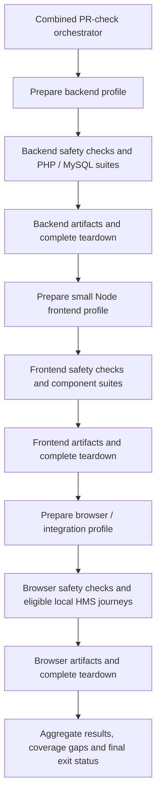

# #TBD_tools_regression_test_harness

Goal: Establish and exercise a high-coverage regression suite for the existing tools capabilities and the shared features on which they depend. Provide repeatable automated runners, harnesses, fixtures, and stubs suitable for a future GitHub pull-request cycle, with verified isolation from production systems and real-world side effects.

Deliver a first reviewable test draft against unchanged application code. Defer any tests that require new application isolation hooks until separately reviewable enabling changes have been delivered.

## Context

- GitHub issue: not yet created. `#TBD` is a temporary identifier; rename and cross-reference this document when the issue exists.
- Working branch: `tools-test-harness` in `GregoryPye/hms2`.
- This task is preparation for improved tool status reporting and management. It establishes regression protection for existing capabilities; it does not implement those product changes.
- The initial review used HMS2 commit `227bdd7f66e9b26da7871f036dbe4df0ec736639` and database submodule commit `12ba6da237b6a97eb92e7efc53bf81c34844bfa8`. Recheck the implementation baseline before writing assertions.
- HMS2 uses PHP 8.4, Laravel 11, Doctrine ORM with YAML mappings, selected Eloquent tables/views, Blade, Vue 2.7, and Laravel Mix. Pest 2, PHPUnit 10, and Mockery are already locked dependencies.
- Existing tests are two examples. There is no substantive regression suite or GitHub Actions workflow in the reviewed checkout. Standard Laravel Eloquent database-reset traits alone do not cover the Doctrine model and SQL routines.
- Tool behavior spans PHP managers/controllers, per-tool roles, shared membership permissions, browser calendars, broadcasts, MQTT, and SQL procedures. Actual RFID sign-on/off, induction, and charging are partly implemented in the pinned database submodule.
- No HMS2 design-document collection, agent navigation guide, or predecessor task decisions currently exist. The copied task guidelines refer to a structured design-document hierarchy from another project; those paths are not HMS2 design sources. Use the code, mappings, SQL, wiki, and explicit decisions recorded here, distinguishing observed behavior from approved requirements.
- The upstream [wiki](https://github.com/NottingHack/hms2/wiki), particularly its authorisation and roadmap pages, supplies historical context. It is incomplete and partly stale; it must not override verified behavior or an explicit decision.
- The cloud workspace initially has no PHP/Composer runtime. Provisioning a reproducible test runtime is part of implementation; do not rely on incidental machine state.

## Requirements outline

### Scope and evidence

- Produce a versioned capability-to-test matrix identifying scenarios, implementation boundaries, test locations, and any exclusions or known defects. Classify each scenario as runnable against unchanged application code, deferred pending an isolation hook, or blocked for another recorded reason; distinguish planned scenarios from implemented tests.
- Test existing tools functionality and the enabling features listed below. Exercise their interaction with tools; high coverage of the entire membership, finance, or access-control systems is outside this task.
- Include successes, rejected operations, boundary conditions, permissions, persisted outcomes, and side effects. Assert behavior rather than duplicating implementation or counting trivial getter tests as substantive protection.
- Generate and actually run the suite under the isolated harness. Report exact commands, baseline revisions, results, coverage, limitations, and reproducibility evidence. Do not claim achieved coverage from static inspection.
- Preserve current public contracts unless a separately agreed defect fix changes them. Record ambiguous or unsafe behavior as a question or known defect instead of silently treating it as correct.
- Keep meaningful failing regressions visible. A temporary expected failure must link to a recorded defect, explain its scope, and appear in reports; do not silently skip difficult cases or count expected failures as successful behavior coverage.

### First-draft boundary and deferred tests

- The first reviewable draft may add tests, runners, fixtures, container definitions, test-only configuration, documentation, and explicitly scoped development-only dependency/lockfile updates. It must not change application PHP/JavaScript, production configuration or runtime dependencies, routes, mappings, migrations, stored routines, views, or the pinned database submodule. It must run against the existing product implementation.
- Use existing constructor injection, framework fakes, and test-owned service bindings where those are sufficient. Do not patch or rewrite application source at runtime, intercept private methods, or introduce brittle class-replacement tricks to avoid acknowledging a missing isolation hook.
- If a scenario cannot be exercised safely and meaningfully without an application change, exclude it from first-draft execution and record the missing hook, affected source/behavior, proposed smallest enabling change, and later test evidence in the matrix. Direct MQTT-client construction is a likely example, not a predetermined list of all exclusions.
- Excluding these tests is an explicit delivery boundary, not permission to relax isolation. Never execute an unsafe scenario merely to raise coverage. First-draft report summaries must prominently list deferred scenarios and the resulting coverage gaps.
- Keep the full intended source scope visible in coverage reports, alongside any first-draft subset. The final high-coverage gates apply after deferred tests are added; the first draft is judged on safety, useful executed assertions, reproducibility, and honest accounting of gaps, without claiming final coverage completion.
- Deliver enabling application changes in a later, separate reviewable change before adding/running the dependent tests. These changes must preserve product behavior, have focused evidence using the available harness, and be clearly distinguished from product bug fixes or new tools features.

### Functional regression matrix

The matrix below defines the eventual regression scope. It does not require every scenario to be executed in the unchanged-code draft; apply the eligibility classification above before running it.

| Capability | Required scenarios and enabling features |
| --- | --- |
| Tool creation and editing | Factory defaults; internal/display names; restricted/hidden flags; price and booking limits; validation and duplicate names; generated roles/permissions and reuse of existing permissions; update persistence; deletion behavior when bookings, usage, or roles exist. |
| Tool availability and presentation | `FREE`, `IN_USE`, and `DISABLED`; reason text and escaping; enable/disable manager effects; hidden-list behavior versus direct access; tool settings/list views; default-disabled creation. Do not invent HTTP endpoints for currently unexposed manager methods. |
| Per-tool grants and audit | User/inductor/maintainer permissions; global versus per-tool authority; grant/revoke and duplicate operations; role persistence; role-update attribution; retained induction access versus removed elevated roles when membership ends. |
| Booking creation | Normal/induction/maintenance permission combinations; restricted and unrestricted tools; outstanding normal-booking limits; invalid dates; zero/reversed durations; maximum length; maintenance exceptions; clashes and adjacent intervals; no persistence/events on rejected operations. |
| Booking editing and cancellation | Ownership; mismatched tool and booking; unchanged values; ongoing bookings; permitted time changes; cancellation persistence; event identity and payload; clash behavior on edits; missing records and route binding. |
| Queries and serialization | Current/next/future queries; every interval overlap shape; tool/user isolation; start/end boundary inclusivity; day/week/month filtering; cancellation/removal behavior; API and broadcast field names, IDs, dates, timezone offsets, and booking types. |
| Actual use and maintenance access | SQL sign-on/off with known/unknown/inactive cards, general permissions, restriction/induction checks, credit limits and pledged time; disabled-tool and maintenance-slot exceptions; usage creation/completion; preservation of disabled availability during maintainer use. |
| Charging and free time | Free-time validation and negative-duration credits; remaining-credit calculation; zero/full/mixed rates; elapsed duration versus recorded active time; maintenance exemptions; transaction type override; balance/transaction outcomes; repeated calls and rollback/error behavior. |
| Card-based induction | Valid/invalid inductor and inductee; permissions; duplicate induction; granted role and audit attribution; chargeable-tool free-time award; failure/rollback behavior. Keep this distinct from simply creating an induction calendar slot. |
| Reporting | Recent usage and date filtering; member access/free-time summaries; booked and used totals; role counts; cached statistics; Prometheus status values and labels; applicable SQL views, including dependencies needed for legacy laser reporting. |
| Browser behavior | Calendar create/move/resize/cancel; loading and failure recovery; ownership and permission controls; broadcast/API arrival order and duplicate suppression; current user's count unaffected by another user's bookings; member grant/free-time forms; mobile layout. |

### Shared enabling features

- Real authentication/authorization boundaries: session and Passport API guards, verified-email requirements where applicable, feature flags, controller middleware, and Doctrine route binding. Authenticate test users through supported helpers for most tests, plus a small number of credential-free local login/token cases. Do not disable all middleware to make feature tests pass.
- Real role/permission relationships for integration tests, including member status and tool-specific templates. Verify shared role-audit listeners in selected tests rather than replacing every event with a fake.
- Member search used by grants: authorization, forced current-member filtering for restricted search permissions, and response-field visibility.
- Doctrine mappings, repository bindings, timestamp/custom Carbon types, schema constraints, and relevant Eloquent interoperability. Use real queries for integration tests rather than mocked query-builder chains.
- Deterministic metadata/content blocks and other minimal records needed to render tools pages. Existing random development seeders and legacy factories are not automatically suitable test fixtures.
- Clock and timezone control: freeze/restore PHP and browser time; cover Europe/London DST and UTC boundaries. SQL `UTC_TIMESTAMP()` is a separate clock: establish a supported database/session-time strategy or bounded relative fixtures and test the actual SQL behavior.
- Queue dispatch, listener registration, transport contracts, and one isolated queued serialization/rehydration round-trip for Doctrine-backed events. Fast tests may fake dispatch; they do not replace all listener/queue tests.

### Safety: no real-world effects

Isolation must be verified before application bootstrap or any destructive setup, and apply to all child processes, test services, and browsers.

- Separate dependency/image preparation from test execution. Preparation may download pinned dependencies, but must use reviewed install/build steps; Composer/npm scripts must not automatically bootstrap an application with inherited settings. Never give preparation scripts production credentials.
- Execute pure unit tests with container networking disabled. Execute service-backed suites on a private network with outbound traffic denied and only the disposable database, application, browser, and explicitly selected test services reachable. Deny external DNS, HTTP/S, MQTT, websocket, SMTP, and raw socket destinations, including via inherited proxies or host gateways.
- Provide a minimal allowlisted environment. Do not inherit production `.env` files, cached Laravel configuration, service credentials, proxy authentication, cloud identities, SSH agents, host credentials, or production database URLs. Prepare a filtered source snapshot; read-only mounting the whole working tree alone does not prevent reading secrets.
- Run test processes without privileged mode, host networking, host filesystem mounts, or a Docker socket. Source is read-only; caches, temporary files, browser profiles, and reports use isolated writable directories. An outer runner may orchestrate disposable containers; the test application cannot control the host daemon.
- Validate effective settings before bootstrap/setup and again after framework initialization: testing environment, YAML Doctrine metadata, approved local database destinations, safe cache/session stores, isolated queue/broadcast settings, and absence of real service credentials. Abort on unexpected settings or cached config; do not merely trust `APP_ENV=testing` or a test-like database name.
- Restrict database credentials to newly created disposable test databases. Validate both Laravel and Doctrine connections. No production schema, mailserver database, or externally hosted database may be reachable or writable.
- Fake mail, notifications, broadcasting, external service clients, and incidental queue work by default. Unexpected calls fail. Laravel HTTP fakes do not intercept arbitrary SDKs, Guzzle instances, MQTT, Kerberos, raw sockets, or browser traffic; retain network-level denial as the independent protection.
- Use recording transport doubles through existing injection points in the first draft. Where this requires a new adapter, such as directly constructed MQTT clients, defer the dependent transport tests until the enabling stage introduces that adapter. Optional actual broker/websocket tests must use disposable local services with no bridge, production credentials, or forwarding route.
- Browser requests, downloads, websockets, popups, and service workers must remain inside the test environment. Account for the external font stylesheet, conditional Stripe script, and Echo configuration. Use local substitutes or controlled responses where needed; fail unexpected destinations rather than silently permitting them.
- Never run `dev/reseed.sh`, production deployment scripts, general queue workers, Horizon, or the scheduler as test setup. The reseed script deletes mailserver records. Exercise only explicitly scoped workers against isolated test queues.
- Use wholly synthetic users, email addresses, card serials, content, balances, and events. No production database dumps or copied member data. Check logs, traces, screenshots, caches, and reports for accidental sensitive content before retaining artifacts.
- Prove the safeguards with bounded negative checks: attempts to inherit sentinel credentials or production-like config fail; an unexpected database target is rejected before destructive actions; HTTP, raw TCP/MQTT, and browser/websocket egress attempts are blocked. Include a test of child-process isolation and a deliberately unexpected transport invocation.
- Safety checks must report failures with clear diagnostics and finite timeouts. Failure to establish isolation is a hard failure, never an automatic fallback to unrestricted execution. Cleanup must run on success, failure, timeout, and cancellation.

### Automation and acceptance

- Expose independently preparable/runnable backend, frontend-component and browser/integration suites, with selectors for their delivered subgroups and safety checks. The combined PR-check command runs these profiles sequentially (or aggregates separate isolated jobs), is the authoritative local entrypoint for the future CI workflow, and exits non-zero on any required failure, blocked required suite or incomplete run. A component/backend success cannot substitute for missing browser/integration evidence.
- A clean checkout with declared prerequisites must run without interactive setup, real credentials, or access to a deployed HMS instance. Pin runtime/dependency versions and database submodule revision; document resources and startup/command timeouts.
- Proposed final coverage gates, after enabling changes and deferred tests: at least 90% executable-line coverage of the core tools managers/factories and at least 85% of the agreed PHP tools/support scope. Measure branch coverage where the selected driver supports it, targeting at least 80% for core decision logic. Confirm the exact source allowlist at baseline and retain uncovered-file reporting; do not narrow it later to conceal gaps. First-draft measurements must show the full-scope gaps separately from any runnable-subset figures.
- PHP coverage does not measure SQL or browser behavior. At final delivery, independently require every agreed critical authorization, booking-boundary, status, and charging scenario in the capability matrix to have executable assertions, with an explicit disposition for known defects. Earlier-stage reports must enumerate scenarios deferred to later stages.
- Include repeat/reorder runs to expose state leakage. Parallel execution is optional initially; do not enable it until database, queue, and artifact isolation are verified. Tests must not rely on wall-clock sleeps, test order, or blanket retries to pass.
- Emit JUnit-compatible results, PHP coverage summaries and machine-readable coverage, frontend coverage, and browser traces/screenshots on failure. Provide a concise run summary including blocked side-effect attempts, known failures, and missing coverage.
- Document GitHub PR integration: locked dependency setup, safety checks before tests, required suite commands, exit codes, artifacts/retention, cancellation, timeouts, least-privilege token permissions, and safe handling of untrusted fork PRs. Do not use `pull_request_target` to execute untrusted code with elevated privileges or secrets. Keep setup caches free of credentials and test config.
- Creating/enabling workflows on GitHub, branch-protection settings, issue creation, commits, and pushes are deferred. This task must still deliver and locally exercise the runner that a future workflow will invoke, plus a concrete workflow specification.
- Add maintained testing documentation explaining prerequisites, architecture, isolation verification, fixtures/stubs, adding another domain, coverage interpretation, failure diagnosis, and reproduction from artifacts.

## Proposed design

### Layered harness

- Extend the existing Pest/PHPUnit/Mockery foundation rather than replace it. Instantiate managers directly with repository doubles for fast tests. Use a minimal Laravel harness only where facades/container behavior is needed, and the full application for routed HTTP tests.
- Introduce `tests/Integration` alongside `tests/Unit` and `tests/Feature`, organised by domain. Keep reusable synthetic entity builders, fixture loaders, transport doubles, and Doctrine reset helpers under `tests/Support`. Tag tests by domain and required resources.
- Use a disposable MySQL server. Start with a pinned MySQL 8.4 LTS release for the initial environment unless repository compatibility evidence calls for another supported MySQL version; record the exact patch version and SQL mode in the smoke report. Confirmation of the production version can follow and may require a compatibility run. MariaDB is outside the initial target, and SQLite is not a substitute for MySQL-specific routines, collations, and transaction behavior.
- Build the test database from repository-owned migrations and the pinned SQL sources, including required functions and views. The existing refresh-procedures command skips functions and has host-specific grants; the harness needs an explicit, reviewed test-only loader and dependency order, not a blind call to production scripts. Do not use reference schema dumps as the schema authority.
- Reset Doctrine persistence state as well as database rows between tests. For ordinary database tests, verified transaction rollback may be used. Procedures such as `sp_tool_charge` commit internally: use database recreation or another proven reset strategy for that suite. Clear relevant EntityManagers after raw SQL so assertions do not read stale identity-map objects.
- Use Jest with Vue 2-compatible transformation and Vue Test Utils v1 for component behavior, with explicit substitutes for FullCalendar, Echo, Axios, jQuery plugins, and clock APIs where appropriate. Pin compatible dependencies without a production build migration. Playwright exercises a smaller set of actual integrated workflows, initially Chromium with desktop and mobile viewports.
- In the first draft, use only existing isolation/injection points. Inventory missing points while building the tests. In the later enabling stage, prefer small injectable transport interfaces where a real client is currently constructed inside a method, especially MQTT. Keep these application changes minimal, separately reviewable, and evidenced as behavior-preserving before adding the dependent tests. Do not perform broad application refactoring or dependency upgrades just to write tests.

### Three independently prepared execution suites

This runtime/resource design is implemented and verified for the delivered 2A foundation/tooling scope. The delivery chunks 2A–2G retain their ownership and order; the three execution suites group those chunks by required infrastructure. Selectors below are working commands; later business suites and actual HMS journeys remain planned. See the [split verification report](../testing/suite-split-report.md).

| Execution suite / implemented selector | Owned tests and delivery mapping | Required runtime resources | Excluded resources |
| --- | --- | --- | --- |
| Backend / `backend` | Foundation PHP/DB checks (2A); SQL functions/procedures/views (2B); rules/repositories/reporting (2C); routed HTTP/authentication (2D); eligible later local queue/contract checks | Pinned PHP, disposable MySQL for service-backed groups, minimal isolated probe services. Pure PHP units use no network. Routed feature tests exercise Laravel locally without a browser. | No Node, Chromium, Playwright image or frontend dependency volume. |
| Frontend components / `frontend` | JS tooling smoke and actual Vue/component cases (2E), including calendar/API/Echo doubles and shared member selection | Small pinned Node image, locked public test dependencies, read-only reviewed component source, disposable caches. Test processes use no network. | No PHP, MySQL, Chromium, full app server or private licensed asset build. |
| Browser/integration / `browser` | Sandboxed Chromium tooling smoke, actual local HMS journeys (2F), and explicitly selected later cross-component/transport cases | Pinned Playwright/Chromium and only each journey's required local PHP application, disposable MySQL and approved isolated stubs. Desktop/mobile checks share eligible prepared tooling. | No unrelated backend fixture services, general worker/scheduler, external HMS instance or production assets/credentials. |

- Preparation must be profile-specific: do not pull/build all three profiles' images or install their dependencies merely to run one suite. Use a small Node image for Jest/component checks; the large Playwright image is reserved for browser/integration checks. Review/pin the new test image and dependencies when implementing this change; no production build migration is authorized.
- The combined runner prepares, verifies isolation, runs and tears down each profile before moving to the next. Complete backend database/canary teardown before creating frontend/browser containers. Network-enabled preparation remains a separate phase with no test application running; no implicit image pulls/package downloads during test execution.
- Retained images/build caches also consume disk after service teardown. Provide a bounded, documented cache policy scoped to labelled harness-owned resources so sequential profiles do not require every profile's cache to coexist. Never broadly prune unrelated Docker resources. The combined workflow may use separate clean workers for the three suites while retaining the same commands and result contract.
- Share bootstrap/fixture definitions and safety logic, not live services or writable state across profiles. Each profile must prove applicable credential/config rejection, network/child isolation and cleanup independently. Use a minimal probe image/service where needed; do not require a large PHP canary for frontend-only execution. Keep read-only source, non-root execution, dropped capabilities and the Chromium sandbox.
- Reuse a test container for related checks only where safe state reset is evidenced; still perform fresh-service repeat cycles. Avoid overlapping large containers and duplicate dependency copies solely for orchestration convenience. Reuse must not conceal clock, listener, ORM, browser-context or fixture leakage.
- Each suite emits its own named result/artifact manifest, suite/test counts, coverage in its own domain, baseline/source checksums, safety outcomes, completed repeats, known defects and deferrals. Combined reporting reconciles these without double-counting or treating an absent/blocked profile as passing. Preserve JUnit/Clover/frontend coverage and sanitized browser failure artifacts as appropriate.
- Measure retained/preparation disk use, incremental peak runtime disk use, memory and cleanup residue per profile and for the sequential combined command. Demonstrate two clean/reordered runs within the declared host budget before claiming the resource blocker resolved; the split is not evidence by itself. Browser/integration may need a separately sized worker if its necessary services still exceed that budget, with the limitation explicitly reported.
- Support the managed environment's existing `vfs` driver. Do not assume `overlay2`, replace/reconfigure the managed daemon or relax isolation to meet the budget. An independently provisioned supported environment may use a more efficient driver, but that is not a prerequisite for the profile separation.

### Known behavior and potential defects

Track these explicitly during baseline creation; findings are from static inspection and need reproduction.

- Booking updates skip clash checking. Define expected rejection/self-exclusion behavior before a fix.
- The original and updated booking in `BookingChanged` currently reference the same mutable object. Decide the intended before/after contract rather than silently accepting aliasing.
- Calendar broadcast handlers change the current user's normal-booking counter without checking booking ownership. Cover cross-user events and API/broadcast arrival order.
- Internal tool renaming leaves role/permission renaming unfinished. Establish whether rename should be prohibited or coordinated; this task does not decide a new identity model.
- Tool enable/disable methods are not exposed by current routes, and the disable notification parameter is unimplemented. Test existing manager effects without inventing a completed management workflow.
- Booking and actual usage are separate: a normal reservation is not checked as an exclusive operating entitlement by the reviewed SQL sign-on routine. A maintenance booking does affect access, without necessarily setting the stored tool status to disabled.
- A maintainer may operate a disabled tool while its stored availability stays disabled. Tests must preserve that distinction.

## Design conformance

This is design-significant because it depends on authorization, persistence, lifecycle, events, and cross-component contracts, and adds an execution/isolation architecture. There are no HMS2 design documents or navigation guide to consult. The sources below establish the starting constraints; observed implementation defects are not automatically normative requirements. The imported template contributes document structure, not domain-design requirements from its source project.

| Design source and section | Behavioural invariant | Affected implementation boundary | Planned or completed evidence | Explicitly agreed variance |
| --- | --- | --- | --- | --- |
| User instruction: protect production credentials/config and prevent real-world effects | Test execution has no production secrets, destinations, or writable production resources; unexpected external work fails | Runner, dependency preparation, bootstrap, database, services, browser, children | Preflight, sentinel/config rejection tests, network-denial checks, reviewed mounts and cleanup | None |
| User decision: three execution suites with lower resource demand | Backend, component and browser/integration suites prepare and run independently; safety and cross-layer evidence remain mandatory | Profile preparation/selection, teardown, cache ownership, probe services and result aggregation | Two clean/reordered runs per delivered profile, measured disk/memory budget, cumulative result reconciliation and cancellation/cleanup evidence | Delivery chunks and final coverage scope unchanged; browser resource/asset blockers remain explicit. No managed Docker driver change. |
| User instruction: unchanged-code first draft, then enabling changes before dependent tests | Reviewers can try the first test draft independently of isolation-hook changes; unsafe or unisolatable scenarios are explicitly deferred | First-draft changeset, eligibility matrix, later isolation interfaces and dependent tests | Application-source diff check, first-draft run/report, separate enabling changeset and subsequent test evidence | First-draft coverage is partial. On 2026-10-15 the user separately authorized quoting the historical invoices migration's `generated` column, with a comment, to resolve MySQL compatibility; no other product changes are authorized by that exception. |
| `composer.json`, `composer.lock`, `package.json`, `package-lock.json`, `phpunit.xml` | Build a reproducible harness around the existing supported stack | PHP/JS runtimes, test runners, setup scripts | Clean-checkout run and recorded versions; explicitly scoped test-dependency additions | No product/framework migration proposed |
| `config/doctrine.php`, `config/database.php`, mappings, migrations, pinned database submodule | Test the actual persistence/query semantics and both ORM boundaries | Database setup, fixtures, Doctrine state, SQL routines/views | Migration/setup smoke check, real repository and SQL outcome tests, repeatable resets | User authorized temporary non-strict/zero-date-permitting modes for the disposable test database and Laravel test sessions. Confirm production compatibility and revisit strict-mode coverage; no production configuration change. |
| `config/roles.php`, `ToolManager`, `RoleManager`, middleware and authentication providers | Global and tool-specific permissions combine; grants have attributable audit effects | Managers, real routes/guards, role relationships and listeners | Permission matrix, denial/no-side-effect tests, audit integration tests | Ambiguities/defects need an explicit decision |
| `BookingManager`, `DoctrineBookingRepository`, booking serialization, API controller and tools events | Ownership, tool identity, time limits, query boundaries, and published contracts are observable | Booking rules, persistence, API, queue/broadcast | Parameterised boundary tests and contract assertions | Clash-on-update and before/after-event findings remain unresolved |
| Tool status/usage entities and `sp_tool_sign_on`, `sp_tool_sign_off`, `sp_tool_charge`, `sp_tool_induct` | Availability, reservations, induction, actual usage, and charge processing have distinct meanings | SQL procedures, roles, tool/usage rows, transactions and reports | Scenario matrix with persisted-state and financial assertions | None; PHP coverage alone is insufficient evidence |
| Tools Vue components, Blade views, statistics action and collector | Browser synchronization, visibility and reporting remain consistent with server outcomes | Frontend, views, cache, metrics | Component tests, browser journeys, reporting/metric assertions | Cross-user booking-counter defect remains unresolved |

Initial review status: static code/wiki/SQL review completed. The user has specified an unchanged-code first test draft, a separate enabling stage, MySQL, and environment setup/smoke testing as the first delivery stage. Stage 1's harness and smoke checks are now implemented and exercised; Stage 2 business regression tests have not started, and final coverage targets remain proposed. Missing HMS2 design documents are recorded explicitly, not treated as an instruction to create an unrelated design hierarchy.

Closure review status: not yet performed. Reconcile every applicable row and capability with actual evidence and any explicitly agreed variance before proposing completion; leave the task file in this directory for the human to move.

Stage 1 conformance review: the source/credential exclusion, network denial, configuration rejection, immutable application snapshot, runtime setup, frontend/browser tooling, restart, and controlled cancellation/cleanup checks have executable evidence in [the smoke report](../testing/stage1-environment-report.md). Initial migration failures and subsequent explicitly authorized remedies are retained there: quote the invoices migration's `generated` identifier and temporarily relax test-only SQL modes. The final two clean cycles passed 38 checks, with no blocked checks and two deferred full-asset checks; migrations, fixture readback and SQL-loader/tool-status smoke checks passed. No application isolation hooks were added. Stage 1 was committed as `3a2546aa` and pushed to the user's fork; enabling GitHub CI remains deferred.

Stage 2 chunking review: the revised plan changes delivery granularity, not domain contracts or the unchanged-product boundary. Each capability has one primary scenario owner and may also have cross-layer contract checks; shared fixtures/reset helpers are delivered first. SQL, PHP, HTTP and frontend evidence remain distinct, so passing one layer cannot substitute for another. The agreed Stage 1 baseline exceptions above carry forward; no new application changes are authorized.

Stage 2A conformance review: preflight/isolation and the new fixture, clock, strict-transport and two reset strategies have executable evidence in the [2A report](../testing/stage2a-foundation-report.md); the unchanged-product diff is clean. The named full coverage scope and scenario ownership are recorded, with no business coverage claim. The initial Docker disk blocker was resolved by the three-profile follow-up: all delivered checks passed two fresh/reordered cycles, independently and cumulatively, with clean teardown. Stage 2A foundation/tooling is complete; business coverage remains planned.

Three-suite design review: profile separation is explicitly authorized and refines the execution architecture without changing application behavior, scenario ownership or safety invariants. Required evidence is independent per-profile isolation/repeatability plus resource measurement and aggregate completeness. The runner now implements this design. The [split verification report](../testing/suite-split-report.md) records 80 required checks passed, two explicit future-journey deferrals, two completed cycles per profile, negative aggregation and cancellation checks, resource measurements and completed ownership-scoped cleanup. Frontend/browser memory sampling was unavailable; enforced limits and disk evidence remain explicit.

Stage 2B verification-scope decision: the user explicitly requested running only the SQL-containing backend profile for this delivery; frontend/browser and the full three-profile regression are deferred to a later run. This overrides the otherwise cumulative cross-profile exit check for this phase, without treating the unrun profiles as passing.

Stage 2B pre-implementation conformance review: use the existing SQL/persistence rows above, unchanged pinned routines and real migrations. Add status/access, induction, charging and reporting suites with synthetic graph fixtures, independent schema recreation for committing routines, persisted money/state assertions and a verified session SQL clock. Preserve isolation gates and three-profile cumulative completeness. Suspected legacy behavior must be reported as a defect or explicit scope limitation, not silently made normative; no application/SQL fixes or production-mode inference are authorized. Evidence planned: two default/reverse cycles, complete previously delivered profiles, SQL scenario accounting and dependency inventory.

Stage 2B conformance review: the [SQL delivery report](../testing/stage2b-sql-report.md) reconciles all 13 SQL scenario families with 80 executable cases per cycle. Two fresh/default-reverse backend cycles produced identical 73 pass / four assertion failure / three SQL error outcomes; all six foundation cases, safety and cleanup checks pass. Persisted-state fault injection exposes non-atomic charging; repeated-sign-on and duplicate-maintenance-log contracts remain explicit failures, and missing legacy schema/grouped-view compatibility remain blocked. No original routine, product code, migration or dependency was changed, and no variance waives those findings. Test-target collation aligns with actual migrations and is verified per case. The user-authorized backend-only scope means frontend/browser are unrun for this phase, not newly passed; complete cross-profile verification remains later work.

Stage 2C pre-implementation conformance review: apply the existing managers/roles/bookings/persistence/event/reporting rows above. Add independently selectable no-network backend rule tests and real MySQL/Doctrine persistence, audit and reporting groups. Verify explicit recording boundaries for outward listeners, execute the real audit and membership-retention logic locally, and serialize queued events without running MQTT. Reproduce clash/update-event/rename ambiguities as failing contracts rather than approving observed defects. Keep the fixed PHP coverage denominator and report core plus wider coverage separately. Backend-only verification carries forward the user's request; rerun completed backend/SQL checks, leaving their existing failures visible. No product or dependency changes authorized.

Stage 2C conformance review: the [backend delivery report](../testing/stage2c-backend-report.md) records 100 new cases over five named suites, independently selectable unit/database execution, actual Doctrine/MySQL interval/DST/query semantics, persisted ACL/audit/membership-retention behavior, local event/queue serialization and real reporting/cache/metric values. Outward work is explicitly recorded; direct MQTT and actual transport delivery remain deferred. Final focused PHP/foundation cycles run in exact reverse order with identical outcomes/assertions: 94 new passes / six contract failures / zero errors, plus all six foundation passes. Core coverage is 98.68%; full fixed-scope coverage is 54.17%, including uncovered files and failing tests. No variance waives remaining failures or the final wider-scope target. The preceding cumulative run repeats unchanged SQL outcomes; its order-dependent harness Gate assumption was corrected and excluded from final PHP evidence. Final safety, checksum, resource and cleanup evidence pass. Product code/dependencies are unchanged; actual routed Gate/middleware coverage remains 2D and full cross-profile regression remains later work.

Stage 2D pre-implementation conformance review: retain the existing route/auth/permission/persistence/event invariants and unchanged-product restriction. Exercise the real HTTP kernel, registered routes, session/Passport guards, email/feature/permission middleware and Doctrine binding against per-case synthetic MySQL state. Bootstrap the request application after fixture permissions exist so real ACL Gate registration is independent of prior cases. Use a small actual local credential/token flow plus supported auth helpers for the larger matrix; no blanket middleware or Gate bypass. Record selected outward events while executing real local role audit. Render actual Blade views with a test-only local asset URL resolver; no private assets or browser fetch are needed for response tests. Evidence planned: independent HTTP selectors, validation/denial/no-write and payload assertions, fresh default/reverse cycles, cumulative backend coverage and explicit defects/limits. No product hooks, dependency changes, GitHub workflows, commit or push authorized by this delivery.

Stage 2D conformance review: the [HTTP report](../testing/stage2d-http-report.md) reconciles the route/authentication/authorization/persistence/event rows with 64 new cases across five independently selected HTTP groups. Actual kernel/middleware/Doctrine binding, real ACL Gate registration after fixtures, local credential/session and signed Passport/revocation flows, real templates and selected local audit are exercised. Strict asset URL resolution and a generated version artifact enable response rendering without private assets; no page/controller/Gate or blanket middleware substitute is used. Resource testing required a test-only page/access process split under the same 128 MB PHP limit. Focused and final cumulative backend runs each complete both default/reverse cycles with identical outcomes/assertion counts. New HTTP results are 61 pass / three failures / zero errors; 250 cumulative cases retain all earlier red findings. Coverage includes failing tests and full-scope gaps; no variance waives DEF-01/12/13, prior findings, or final coverage targets. Safety/reset/checksum/cleanup evidence passes; actual transport/browser behavior and full cross-profile regression remain deferred. Product code, views, routes and dependencies are unchanged.

Stage 2E pre-implementation conformance review: apply the frontend/state/event and unchanged-product rows above. Mount actual tools Vue components plus MemberSearch, MemberSelectTwo and their SelectTwo wrapper with the existing isolated Node/Jest profile. Add pinned public test-only Vue SFC transformation and matching public runtime helpers; use bounded recording FullCalendar/Axios/Echo/plugin doubles rather than booting the production entrypoint or assets. Freeze timers/time, explicitly settle promises, restore globals and destroy wrappers; prove ordinary and reordered runs, fail on unexpected requests, and report full seven-component coverage including uncovered code. Reproduce DEF-03 and independently evidenced cleanup/loading/state defects as failing contracts. No product edits or CI activation. The user additionally requested an unchanged copy of the supplied agent-definition repository's production .codex; scanner/tracer role instructions were useful for read-only discovery with available session models, and imported legacy model names remain unchanged.

Stage 2E conformance review: the [component report](../testing/stage2e-component-report.md) reconciles UI-01–05 with 98 actual mounted-component cases across all four Tools SFCs and three shared selectors. Local recording ports exercise callback/payload/ownership/loading/order/duplicate/count and native-form contracts without production bootstrap, private assets or transport delivery. Both fresh frontend cycles complete, with all four groups reordered in cycle two and identical named outcomes/passing-expectation counts/coverage. Results are 91 pass / seven contract failures / no skips or suite-load errors; DEF-03 and new DEF-14/15/16 remain failing without product fixes or waivers. Fixed seven-SFC compiled coverage is 508/508 statements, 507/507 lines, 137/137 functions and 188/208 branches, including failing tests and generated render glue; it is separate from PHP/SQL/browser evidence. A test-only transform corrects double instrumentation rather than narrowing scope. All safety/cleanup gates and nine host control-plane tests pass. Real plugin/browser integration and transport cancellation remain explicit limits; no new product isolation hook was required. Only the relevant frontend profile was run for this increment; complete current cross-profile evidence remains 2G.

## Legal terms and conditions conformance

Initial review: the imported task guidelines assume a versioned legal-terms manifest at `docs/legal/terms/manifest.json`; HMS2 has no such manifest. The repository has an MIT `LICENSE`; its privacy-and-terms page renders a database-backed content block, so the full deployed terms cannot be established from that Blade file alone. Do not claim the absent manifest has been reviewed.

This task proposes development/test infrastructure using synthetic data, with no user-facing policy change, production data access, external messages, or acceptance-date change. No terms amendment is proposed. Preserve applicable licence notices and assess licences for any test dependencies or fixture/assets introduced. In particular, the frontend uses Font Awesome Pro: do not copy licensed assets or expose a registry token as an expedient test fix.

Closure review: pending implementation. Confirm synthetic-only fixtures and sanitized artifacts. If a potential conflict with applicable terms or asset licensing is discovered, record it below for an explicit decision; do not change legal terms automatically.

Stage 1 review: synthetic configuration/data only; no production data or private font assets used. The test-only browser seccomp profile includes its upstream Apache-2.0 licence/provenance and documents the namespace-local sandbox allowance. The project licence and user-facing terms are unchanged; later fixtures/dependencies and full task closure still require review.

Stage 2A legal review: own test/support code and synthetic fixtures only; existing locked tooling reused without new third-party dependencies, private assets or production records. No user-facing terms or licence change was introduced. No potential terms conflict was identified; retained fixture reports contain synthetic data, and full task closure remains pending.

Three-suite legal review: pinned public Node and BusyBox images were added for runtime/probes, with upstream notices retained in the distributions (Node licensing and BusyBox GPL-2.0). No runtime binaries or private fonts were copied into the repo. Separate locked public JS tooling, own support code and synthetic data only were used; no production data access, user-facing terms change or potential terms conflict was identified.

Stage 2B test-target alignment: initial executable SQL calls exposed MySQL 8 default/routine-parameter collation mismatch with the actual migrated tables. The disposable server and recreated schema now use `utf8mb4_unicode_ci`, with per-case assertions; no product migration or SQL definition is changed. Production collation remains a compatibility question.

Stage 2B pre-implementation legal review: own test/support code, existing pinned public runtimes and synthetic data only; no new third-party package, real card/user/account, licensed asset or outbound integration required. No terms change or potential conflict identified; the absent legal manifest remains explicitly unreviewable.

Stage 2B legal closure review for this increment: synthetic identities/cards/accounting rows and tokens only; own test/support changes with existing locked public tooling. No third-party dependency, licensed asset, production record, external client invocation or user-facing terms change introduced. Retained artifacts contain synthetic data; no potential terms conflict found. Whole-task closure and later additions remain subject to their own review.

Stage 2C pre-implementation legal review: own tests/support, existing public locked dependencies and synthetic fixture graphs only. Mail/queue/broadcast/SDK work must be strictly recorded or deferred; no private asset, live card, external account or production record needed. No terms change or potential licence conflict identified; the absent legal manifest remains unreviewable.

Stage 2D pre-implementation legal review: repository-owned routes/views and synthetic fixtures only, existing public locked PHP dependencies and temporary generated test-only OAuth keys. No production secrets, member records, private assets or external service use. No potential terms conflict or terms change identified; the repository still has no legal manifest to review.

Stage 2D final legal review: only own tests/harness/documentation, existing public locked dependencies and synthetic fixture/OAuth data were used. Private assets and production credentials/data were neither required nor imported; no external service delivery or terms change occurred. No potential conflict identified; the absent legal manifest remains unreviewable.

Stage 2E pre-implementation legal review: original repository components and own test doubles/fixtures, with pinned public test-only dependencies. No private Font Awesome dependency, compiled production assets, member data, real credentials or external service delivery is needed. No potential terms conflict or terms change identified; no legal manifest exists to review.

Stage 2E legal conformance review: only original component source, synthetic fixtures/recording ports and public pinned test packages were used. No private asset build, registry credentials, deployed terms/data or external delivery was needed. No potential terms conflict or terms change identified; the absent legal manifest is not represented as reviewed.

## Delivery plan

The following staged delivery reflects the user's requested ordering. The three execution profiles and 2A resource follow-up are implemented and verified. The initial failed monolithic evidence is retained below as history; the split report supplies completion evidence. Stage 1 has been committed and pushed; creation/enabling of GitHub workflows and branch protection remains deferred.

### Stage 1: Set up and smoke-test the isolated environment

- Provision the pinned PHP 8.4/Composer runtime and disposable MySQL instance, plus Node/browser tooling needed for the planned layers. Keep dependency preparation separate from isolated execution and record versions, prerequisites, and SQL mode.
- Establish filtered source/configuration, credential exclusion, network denial, disposable writable storage, bounded commands, and reliable cleanup before bootstrapping HMS or creating schema objects. Verify the isolation preflight and its negative checks.
- Smoke-test PHP test discovery/execution against unchanged code, the MySQL connection and schema/routine loader, minimal synthetic fixture persistence/readback through Doctrine and Laravel, and a safe application bootstrap. Smoke-test frontend tooling without downloading private assets or contacting external services; record an asset-related browser blocker separately if necessary.
- Do not fix product code or alter SQL sources to make the smoke checks pass. Record exact blockers and isolate their impact; a failed prerequisite must not be reported as a successful smoke test. Safely runnable independent layers may proceed, but no affected suite is ready until its prerequisite passes.
- Exit evidence: a reproducible environment/smoke command, sanitized results with explicit pass/fail/blocker status per layer, successful safety checks, pinned versions, and an unchanged-application diff check. Exercise teardown and a second clean startup to verify repeatability.

Execution status: Stage 1 delivered, committed and pushed. After the explicitly authorized identifier fix and temporary test-only SQL-mode relaxation, two clean cycles completed with 38 passing checks, no blocked checks and two deferred full-asset checks (exit 0). This establishes smoke readiness under the recorded relaxed mode, not tools regression coverage or strict-mode compatibility. Full HMS browser journeys remain asset-dependent. See [the smoke report](../testing/stage1-environment-report.md) and the remaining compatibility TODO below.

### Stage 2: Deliver the first regression-test draft in independently verifiable chunks

Use the Stage 1 baseline, including its explicitly authorized identifier fix and temporary test-only SQL-mode settings. No further product changes are included in Stage 2. Layer-oriented chunks are appropriate because SQL routines need real MySQL and commit-aware resets, PHP rules/repositories need Doctrine-aware fixtures, HTTP needs actual guards/middleware, and frontend components can run without the unresolved complete-asset build. Keep browser integration separate so asset or transport blockers do not obscure completed component/backend evidence.

Default delivery order is 2A through 2G. After 2A, SQL, backend and component work have some independent scope; this permits reordering when a prerequisite is blocked, not unverified parallel execution. Do not force unrelated layers to wait for each other or declare a blocked chunk complete. Each chunk is a separately reviewable test/harness/documentation increment; do not automatically commit or push it without authorization.

#### Common completion rules for every chunk

- Map every planned case to a capability/scenario ID, owning chunk, source boundary and test location. Assign a primary owner to avoid duplicate exhaustive suites; use selected cross-layer cases to verify integration. Record runnable, isolation-hook-deferred, other-blocked and known-defect cases separately, with reasons and next steps.
- Execute the chunk through the isolated runner, verify its applicable safety gates, and demonstrate repeatable clean state with a second run. Database resets must handle both ORM state and routines that commit internally; frontend cases must restore clocks, mocks, listeners and mounted components.
- Extend the cumulative local PR-check command as executable suites arrive, routing each test group to its backend, frontend or browser profile. Before closing a chunk, run its tests and all previously completed applicable suites sequentially with teardown, or aggregate equivalent separately isolated jobs; a dependency/resource blocker is reported explicitly, never a silent skip. Do not advertise unimplemented profile/suite selectors as successful checks.
- Keep meaningful failures visible. Reproduced product defects need a recorded disposition; any expected failure must be explicitly reported and excluded from passing coverage. Do not fix product behavior or weaken assertions merely to close a chunk. Cases requiring a new product hook move to Stage 3/4 with their proposed smallest enabling change.
- Update maintained instructions, scenario status, scoped/full-scope coverage gaps and Delivery tracking with exact commands, baseline, results, repeat/reset evidence, defects and remaining work. Generated logs belong in ignored artifacts; repo-worthy summaries and scenario definitions must persist in documentation.
- A chunk is clean when its declared scope has evidence and every gap has an explicit disposition. An unresolved required failure/blocker keeps that chunk open; a justified Stage 3/4 deferral is visible and does not count as a passed scenario. Chunk completion does not imply the final high-coverage gates have been met.

#### Stage 2A: Capability inventory and shared regression foundation

- Recheck the baseline and define the source/coverage allowlist. Expand the functional matrix into scenario IDs, owner chunks, dependencies and eligibility classifications, including known defects and missing isolation hooks.
- Extend Stage 1 into reusable regression commands and test support: deterministic user/card/tool/role builders, Laravel/Doctrine bootstrap, clock control, metadata/content fixtures and default fail-on-unexpected-transport doubles through existing bindings. Create helpers only as required by the first representative tests; do not build an unrelated general framework.
- Establish and verify ordinary database rollback/EntityManager clearing and a separate recreation/reset path for committing SQL routines. Never run development seeders or production reset scripts. Establish the unit, integration, HTTP and JS suite/report conventions and a cumulative runner without requiring later suites to exist yet.
- Exit evidence: versioned scenario/eligibility inventory; focused executable checks proving isolation, fixture readback and both database reset paths; a repeatable isolated regression entrypoint with machine-readable results. Later chunks reuse this support rather than invent independent bootstrap/reset mechanisms.

##### Stage 2A resource follow-up: implement and verify the three-suite split

1. Add explicit profile-specific preparation/manifests and selectors for `backend`, `frontend` and `browser`, following the design above. Pin a small Node runtime for component tooling and use minimal probe resources; retain source/configuration exclusion and fail-closed preparation integrity checks.
2. Separate the runner lifecycle so backend services are completely removed before frontend/browser work. Add bounded harness-owned cache handling and result aggregation; retain the current required smoke checks, assigning browser tooling smoke to its own profile. A browser tooling fixture still does not satisfy future actual HMS journey requirements.
3. Exercise each profile independently and the sequential combined command with two clean/reordered cycles, negative isolation checks and retained machine-readable results. Record measured resource peaks and cleanup; verify that a required profile failure remains a nonzero aggregate result. Keep asset-blocked future journeys distinct from runnable tooling checks.

Status: completed; see the [split verification report](../testing/suite-split-report.md).

Exit evidence: all delivered foundation/tooling checks pass in their assigned profiles and the combined result honestly reconciles them within the recorded host budget, with no hidden omissions or production changes. Retain the previous failed monolithic run as historical evidence; 2A closure requires the implemented execution design and passing repeatability/resource evidence (now supplied for delivered foundation/tooling). If browser/integration still needs a larger worker, record its measured requirement and unresolved execution status rather than closing the whole prerequisite as green.

#### Stage 2B: Database functions, procedures and views

- Exercise pinned SQL behavior with synthetic cards, users, roles, tools, usage and balances. Cover status queries, sign-on/off, disabled/maintenance distinctions, induction, free-time/charging outcomes, rejection paths, rollback/error behavior and relevant reporting views/functions.
- Group cases by status/access, induction, charging and reporting, with persisted-state/financial assertions. Use the verified commit-aware reset strategy and bounded relative SQL-time fixtures or another evidenced clock strategy; clear Doctrine state before cross-reading SQL mutations.
- Exit evidence: an independently runnable SQL suite with scenario pass/defect/deferred accounting, repeat/reset proof after committing procedures, and required SQL dependency/loader instructions. SQL scenario coverage is explicit; PHP coverage is not used as its proxy. Inventory unresolved legacy-reporting dependencies rather than silently omitting them.

#### Stage 2C: Backend rules, repositories and reporting

- Deliver focused case groups for tool lifecycle/grants/audit, booking creation/edit/cancel, and queries/serialization/reporting. Cover factories, managers, permission combinations, boundaries, no-side-effect rejection, actual Doctrine query semantics, ORM interoperability, statistics/cache and Prometheus outputs where safely exercisable.
- Use fast repository doubles for rule tests and real MySQL/Doctrine for persistence/query assertions. Test the role-audit and membership-retention dependencies selected in the matrix; do not replace all listeners with fakes. Include safe event contracts/serialization using existing isolation points and explicitly defer transport paths needing hooks.
- Exit evidence: independently selectable backend unit/integration groups, real persistence and query-boundary assertions, scoped plus full-allowlist PHP coverage, and clear reproductions/dispositions of booking clash/update-event ambiguities. SQL business-rule exhaustiveness remains owned by 2B; selected cross-reads verify their shared state contract.

#### Stage 2D: Routed HTTP, authentication and authorization

- Exercise real tools/booking web and API routes, session/Passport guards, verified-email/feature gates, middleware, Doctrine binding, ownership, validation, member search and grant/free-time endpoints. Cover denial and mismatched-record paths with persisted-outcome and response/payload assertions.
- Reuse domain fixtures and rules already covered in 2C. Keep a small credential-free local authentication/token set, with supported authentication helpers for the broader permission matrix; do not disable middleware globally or invent endpoints for unexposed manager methods.
- Exit evidence: independently runnable HTTP feature suite, relevant route/guard/permission matrix and no-side-effect denial evidence. Backend fixtures/prerequisites must be ready for each included workflow; unresolved hooks are deferred rather than invoked unsafely.

#### Stage 2E: Frontend component behavior

- Test the actual tools Vue components and shared member-selection pieces they use. Cover calendar create/move/resize/cancel handling, loading/error recovery, ownership controls, API/broadcast ordering and duplicates, cross-user booking counts, and grant/free-time/usage forms as applicable.
- Use explicit local doubles for FullCalendar, Axios, Echo and plugins; assert actual component behavior and contracts, not only template compilation. Keep component tests independent of private Font Awesome assets and a deployed HMS instance. Stubbed-component checks do not establish actual calendar-library/browser integration.
- Exit evidence: independently runnable component suite with frontend coverage, deterministic clocks, cleanup/repeat evidence and explicit known-defect cases. Any asset or missing-hook limitations are listed separately; no private registry credentials are used.

#### Stage 2F: Integrated browser journeys

- Select a small set of actual HMS journeys using the local application, real test HTTP routes and synthetic database: tool visibility/details, an authorized booking lifecycle and a grant/free-time path where safely supported. Exercise desktop/mobile behavior and key failure/permission handling without duplicating the entire lower-layer matrix.
- Requires the relevant 2C/2D workflows, 2E component evidence, and an agreed credential-free licensed asset strategy. Keep real browser HTTP/websocket egress denial and transport controls. Deliver eligible journeys; if full assets or new hooks remain unavailable, leave affected journeys explicitly blocked/deferred and continue independent work in 2G.
- Exit evidence: real local HMS journey assertions and sanitized failure artifacts, or an explicit remaining browser blocker/deferred inventory. The Stage 1 HTML tooling fixture and mocked component checks cannot satisfy this chunk's integrated-journey evidence.

#### Stage 2G: Consolidate the first draft and review evidence

- Reconcile all scenario owners and cross-layer contracts, audit deferrals/known failures, and run the three-profile cumulative local PR-equivalent command from clean profile-specific preparation, with teardown between profiles and reconciled artifacts. Repeat/reorder applicable suites to expose fixture, clock, identity-map and event-listener leakage.
- Publish maintained testing instructions, result/coverage interpretation with full-scope gaps visible, and a concrete future GitHub workflow specification. Ensure the combined command reports failures and missing required layers honestly; an asset-blocked browser suite is not a green browser result. Do not enable GitHub CI in this chunk.
- Exit evidence: a reviewable first draft that the wider group can try without new application hooks, repeatable isolated commands, machine-readable results and coverage, a reconciled scenario/deferral inventory, and proposed smallest Stage 3 hooks with the Stage 4 tests each unlocks. Do not claim Stage 2 fully complete while a required chunk is unresolved; report the usable draft and remaining blockers. Final high-coverage acceptance remains Stage 4.

### Stage 3: Deliver the required enabling application changes

- After review of the first draft, implement the agreed smallest isolation/injection hooks as a separate reviewable changeset. Keep each change tied to an inventoried limitation and preserve current runtime behavior.
- Run the existing draft suite and focused checks of the new interfaces with recording doubles. Do not mix tool feature enhancements or unrelated bug fixes into this stage.
- Exit evidence: separately assessable enabling changes, preserved contracts, passing applicable draft checks, and verified safe isolation points. Finish this stage before introducing the remaining dependent regression tests.

### Stage 4: Add deferred tests and complete coverage and automation evidence

- Add and run the tests unlocked by the enabling changes, including the deferred transport/queue or cross-component cases. Complete the scenario matrix, final coverage measurements, reorder/repeat checks, and documented known-defect dispositions.
- Reconcile the design/safety evidence and publish local run instructions and the final PR-check/workflow specification. Review all reports and artifacts for sensitive content.
- Exit evidence: the final coverage gates or explicitly agreed variances, verified safety across all executing layers, clean-checkout repeatability, and a locally exercised PR-equivalent command. Enabling GitHub workflows and branch protection remains later work.

## Delivery tracking

- 2026-10-15: Created the task document from the imported template, incorporating the repository/SQL/wiki assessment, tools dependencies, automation requirements, and independent isolation safeguards. Only this document was added for this request; no application/test code, dependency installation, test execution, or GitHub changes were performed. All coverage figures above are proposed acceptance targets, not measured achievements.
- 2026-10-15: Revised the task to deliver the isolated environment and smoke tests first, followed by an unchanged-application test draft, separate enabling changes, and then dependent tests. Assumed MySQL, replaced private-project references with descriptions of the imported guidance, and kept later decisions below. Only this task document was edited; no implementation or test execution has begun.
- 2026-10-15: Implemented the Stage 1 runner, pinned PHP/MySQL/browser images, public frontend tooling lockfile, filtered source preparation, safety gates, test-only bootstrap, and smoke diagnostics under `tests/Environment`. Two independent clean cycles produced 32 passing checks, six blocked checks from the existing MySQL migration failure, and two explicitly deferred full-asset checks; evidence and reproduction instructions are in `docs/testing/stage1-environment-report.md`. Original application code, configuration, migrations, dependency manifests and pinned SQL sources remain unchanged; Stage 2 and GitHub publication have not started.
- 2026-10-15: The user authorized the specific MySQL compatibility fix identified by Stage 1: quote `generated` in the historical invoices migration and add a reason comment. Applied that narrow change without renaming the column or changing its definition, and rebuilt the isolated snapshot for a fresh two-cycle smoke run; both cycles confirmed the identifier fix, with 32 passing checks, six checks blocked by the later strict-date migration/incomplete schema, and two deferred full-asset checks. Cleanup passed; details are recorded in the smoke report. No other application or SQL source changes are included.

- 2026-10-15: The user authorized temporarily relaxing strict SQL mode in the disposable smoke database. Removed strict and zero-date rejection modes from its startup settings, aligned test-only Laravel connection modes, and added TODO comments to investigate production compatibility and restore appropriate coverage. Production configuration and timestamp migrations remain unchanged; fresh two-cycle verification completed with 38 passing checks, zero blocked checks and two deferred full-asset checks (exit 0). Both migration suites, fixture readback and routines/tool-status procedure passed; cleanup left no smoke containers or networks. Evidence: `/tmp/hms-nonstrict-final/report.json` and the updated environment report. Strict-mode compatibility remains a TODO.

- 2026-10-15: Reviewed Stage 2 against the current SQL, PHP, routes and Vue boundaries and split it into 2A–2G: shared foundation, SQL, backend, HTTP, components, integrated browser journeys, and consolidation. Added dependencies, per-chunk exit evidence, cumulative verification/reset requirements and a status table; unchanged-product and safety constraints remain. Reconciled stale Stage 1 readiness/publication text with the completed smoke run and authorized commit/push. This revision changes only this task document; no Stage 2 tests were implemented or run.

- 2026-10-15: Implemented 2A's [scenario/eligibility inventory](../testing/tools-regression-inventory.md), fixed 47-file PHP coverage scope, shared guarded bootstrap/SQL loader, synthetic builders, restoring PHP clock, strict transport expectations, ORM rollback/recreation helpers, and isolated cumulative `pr-check` with JUnit/Clover artifacts. All six foundation tests passed once with 45 assertions; product/harness/regression checksum negatives rejected stale snapshots before Docker. The full two-cycle attempt exited 1 with `incomplete` (20 passing checks, three blocked, one deferred): cloud Docker ran out of disk creating frontend/browser containers, then blocked cycle 2's canary, so reverse-order repeat evidence is not complete; cleanup left no smoke containers/networks. Standard cleanup of identified harness/build resources was insufficient; details, trial fixes, exact commands, coverage and required rerun are in the [2A report](../testing/stage2a-foundation-report.md). Only tests/harness/documentation changed, with no application or product dependency changes, new production hooks, CI activation, commit or push; keep 2A open until the cumulative rerun succeeds on a host with adequate space.

- 2026-10-15: The user approved redesigning execution into backend, frontend-component and browser/integration suites after the 2A disk failure and managed-driver assessment. Recorded profile-specific preparation, small Node tooling, independent safety controls, complete teardown between profiles, bounded harness-owned caches, per-suite resource evidence and cumulative reporting without weakening browser requirements. Added an explicit 2A implementation/verification follow-up and mapped 2B–2G to execution profiles; 2A remains open and previous results remain historical. This change edits only this task document; the runner has not yet been changed to implement the split, no tests were run for this revision, and no commit/push was performed.

- 2026-10-15: Implemented the three-profile split with independent pinned dependencies, read-only source/dependency volumes, fresh cycle services, safety gates, exact ownership-scoped cache cleanup and strict aggregate completeness. Each profile passed two independent cycles and the final sequential combined command passed **80 required checks**, with two explicit actual-HMS-journey deferrals; six PHP foundation tests made 45 assertions per cycle. Four host control-plane tests passed; real-report aggregation rejected failed/missing/stale/omitted-required evidence, and controlled cancellation returned 130 with cleanup. Peak sampled filesystem use was 26.16 GiB with 3.67 GiB minimum free on the existing 32 GB `vfs` host; final settling cleanup left no owned caches, test containers or private networks. Stage 2A foundation/tooling and resource follow-up are complete; see the [split verification report](../testing/suite-split-report.md). Product code/dependencies are unchanged; later business tests, actual HMS journeys and CI activation remain planned. No commit or push performed.

- 2026-10-15: Delivered the 2B SQL test increment: four selectable PHPUnit suites, shared synthetic SQL fixtures, verified session SQL clock, per-case real schema recreation, persisted money/state assertions, fault triggers and machine-readable test/failure counts. Corrected initial test-fixture API/schema assumptions and aligned disposable schema/routine collation to the actual migrated tables; the initial cancelled trials are not passing evidence. Final backend-only `pr-check --cycles 2 --output /tmp/hms-2b-aligned` completed both cycles with exact reverse case order and identical results: **80 SQL cases/cycle, 73 passed, four assertion failures, three SQL errors (569 assertions)**; six foundation cases passed with 45 assertions/cycle. The command correctly exits 1/blocked (42 passing groups, six blocked), preserving DEF-06/07/08, LEGACY-01 and COMPAT-02 rather than accepting faulty behavior. All safety/cleanup checks and six controller tests pass; minimum free disk was 3.67 GiB, sampled peak use 26.16 GiB and aggregate container memory about 932 MiB. No test containers/private networks remain; prepared backend caches are retained. Per the user's explicit instruction, frontend/browser/full aggregation were not run. Product diff remains clean; findings/questions and exact evidence are in the [2B report](../testing/stage2b-sql-report.md). No product fix, workflow activation, commit or push performed; 2B's red findings remain open.

- 2026-10-16: Delivered the 2C test increment and final repeat evidence after resuming interrupted work: 70 no-kernel/no-network unit cases plus 30 real MySQL/Doctrine repository, lifecycle/audit, membership-retention and reporting cases. Added backend PHP/unit-only/database-only selectors, machine-readable union coverage and a seventh controller check; partial runs cannot satisfy complete aggregation. Corrected test-only inverse-collection, detached-entity, legacy discovery and pre-fixture Gate-registration assumptions; trials are disclosed in the report. Final `pr-check --profile backend --suite backend --cycles 2 --output /tmp/hms-2c-php-final` completed default/reverse cycles with identical per-case outcomes/assertions: **100 new cases/cycle, 94 pass / six assertion failures / zero errors, 451 assertions**; six foundation cases pass with 45 assertions. Required gate exits 1 (46 passing groups, four blocked), retaining DEF-01/02/04 and newly recorded DEF-09/10/11. Coverage is **224/227 core lines (98.68%) / 728/1,344 full-scope lines (54.17%)**, including failing tests and all 47 allowlisted files; wider final gates and HTTP/frontend/transport layers remain outstanding. The preceding cumulative backend run completed both cycles and reconfirmed unchanged SQL outcomes (73/80 pass, four failures, three errors); its PHP Gate-assumption failure is superseded only by the corrected focused run, not claimed green. All final safety/cleanup gates and seven controller tests pass. Final sampled disk peak/minimum free were 26.17/3.67 GiB, memory about 925 MiB; no containers/private networks remain and owned backend caches are retained. Exact commands, artifact locations, scope limits and conformance are in the [2C report](../testing/stage2c-backend-report.md). No application/SQL/dependency changes, CI activation, commit or push performed; findings keep 2C open.

- 2026-10-16: Delivered 2D's five routed HTTP groups and independent `--suite http` selector with real kernel/middleware/Gates/Doctrine bindings, local credential/session and signed/revoked Passport flows, actual Blade/layout responses, booking/CRUD/search/grant/free-time persistence and real local audit. Test-only enabling corrections fixed an invalid public fixture hash (new foundation assertion), updated migration-owned metadata fixtures, supplied an immutable generated version and strict local asset URL resolver, released application references and split page/access groups to respect 128 MB PHP; no product hook or dependency changes. Final focused and cumulative backend commands each completed two fresh/default-reverse cycles with identical per-case outcomes/assertion counts. **64 HTTP cases/cycle: 61 pass / three assertion failures / zero errors, 763 assertions**; DEF-01 remains and DEF-12 (missing advertised show method) / DEF-13 (omitted free-time amount yields 500) are recorded. Final cumulative `/tmp/hms-2d-cumulative/report.json`: **250 cases/cycle, 234 pass / 13 assertion failures / three existing SQL errors, 1,829 assertions**, gate exits 1 (54 passing groups, 14 blocked). All safety/prerequisite/cleanup gates and seven host controller tests pass. Coverage is **224/227 core lines (98.68%) / 1041/1,344 full scope (77.46%)**, with all 47 files and failing-test execution explicit; wider final targets remain unmet. Sampled filesystem peak/minimum free: 26.17/3.67 GiB; incremental peak 2.74 GiB. Observed aggregate container memory peak about 1100 MiB over 259 samples. These are sampled observations on the unchanged managed `vfs` host, not resource guarantees. No containers/private networks remain; owned backend caches are retained. [2D report](../testing/stage2d-http-report.md) preserves commands, artifact paths, trial corrections, coverage/limits and decisions. Backend-only scope carries forward; frontend/browser/CI activation, product fixes, commit and push remain deferred. Findings keep 2D open.

- 2026-10-16: Delivered 2E's independently runnable frontend component suite with pinned public SFC compilation/helpers, strict FullCalendar/Axios/Echo/plugin ports, deterministic clock/promise/DOM setup and wrapper cleanup. Added full seven-SFC Istanbul exports/count validation, separate smoke/business required checks and two controller regressions. Review corrected ID-deduplicating doubles, unrealistic type-change characterization, stale artifact reuse, interleaved report export and double instrumentation; initial trials are not accepted coverage. Final `/tmp/hms-2e-final/report.json` completes two fresh/default-shuffled cycles with identical named outcomes/passing-expectation counts and coverage: **98 new cases/cycle, 91 pass / seven assertion failures / no skips or suite-load errors**, 888 passing expectations (not total executed assertions). Existing DEF-03 and new DEF-14/15/16 stay red; two separate tooling cases pass per cycle. Gate exits 1 (20 passing check groups / two blocked), while all safety/cleanup and nine host controller tests pass. Fixed compiled-SFC coverage: **508/508 statements, 507/507 lines, 137/137 functions, 188/208 branches (90.38%)**, including render glue and failing tests; PHP/SQL/browser evidence is separate. Final sampled disk peak/minimum free: 14.81/15.03 GiB, execution increment about 0.46 GiB; observed container memory about 42.0 MiB with only one successful sample, not a peak guarantee. No test containers/private networks remain; prepared frontend cache is retained and prior owned backend cache was evicted. The [2E report](../testing/stage2e-component-report.md) records commands, artifacts, limits, findings and unchanged product/tooling checksums. Application/SQL/product dependencies remain unchanged; backend/browser/full aggregation, CI activation, commit and push were not performed. The user-requested four agent configuration files were copied byte-identically from the supplied production-branch revision; unavailable legacy model names were preserved, and useful discovery/review used available read-only session agents.

### Stage 2 chunk status

Update each row as delivery proceeds. Stage 2A foundation/tooling is complete with verified three-profile execution. Stage 2B SQL tests are implemented with recorded product/legacy findings; Stage 2C backend tests are implemented and independently repeated with findings recorded below; Stage 2D HTTP tests are independently and cumulatively repeated with findings recorded below; Stage 2E component tests are independently repeated with findings recorded below; chunks 2F–2G remain planned. Stage 1 smoke successes are prerequisites, not completed regression scenarios.

| Chunk | Status | Evidence / remaining prerequisite |
| --- | --- | --- |
| 2A — Inventory and shared foundation | Complete — foundation/tooling | Six PHP tests / 45 assertions per cycle; all three profiles passed two cycles independently and cumulatively. 80 required checks passed, two future-journey deferrals; resource, negative-report and cleanup evidence in the [split report](../testing/suite-split-report.md). |
| 2B — SQL functions/procedures/views | Implemented; findings remain open | Two backend cycles: 80 SQL cases each, 73 pass / four failures / three errors; exact reverse order and identical outcomes. Foundation/safety pass. See the [2B report](../testing/stage2b-sql-report.md); DEF-06/07/08 and LEGACY-01/COMPAT-02 remain open, gate exits 1. No product fix. |
| 2C — Backend rules/persistence/reporting | Implemented; findings remain open | Two final focused backend cycles: 100 new cases each, 94 pass / six failures / zero errors, 451 assertions; exact reverse order and identical outcomes. Foundation/safety pass. Core line coverage 98.68%, full fixed scope 54.17%; DEF-01/02/04/09/10/11 remain open. See the [2C report](../testing/stage2c-backend-report.md); gate exits 1, no product fix. |
| 2D — Routed HTTP/authentication | Implemented; findings remain open | Five HTTP groups: 64 cases/cycle, 61 pass / three failures / zero test errors, 763 assertions; identical in reverse order. Final cumulative backend repeats all 250 cases with unchanged earlier findings. Core/full line coverage 98.68% / 77.46%; safety/cleanup pass. DEF-01/12/13 remain open; [2D report](../testing/stage2d-http-report.md), gate exits 1. |
| 2E — Frontend components | Implemented; findings remain open | Two frontend cycles: 98 new cases each, 91 pass / seven failures / no skips or suite-load errors; identical after seed-42 case shuffle. Seven compiled SFCs: 100% statements/lines/functions, 90.38% branches, including failing tests. DEF-03/14/15/16 remain open; safety/cleanup pass, gate exits 1. See [2E report](../testing/stage2e-component-report.md). |
| 2F — Integrated browser journeys | Planned; browser profile, asset prerequisite unresolved | Relevant 2C/2D/2E workflows and credential-free licensed asset strategy. |
| 2G — Draft consolidation | Planned; aggregate all three profiles | Reconcile delivered chunks; retain unresolved chunks and deferrals visibly. |

## Answered implementation questions and notes

- Tools are the primary target; include shared enabling capabilities in the context of their tools workflows, not a claim of whole-application coverage.
- No GitHub issue exists yet. Use `#TBD` temporarily and add the real cross-reference later.
- HMS2 has no structured design-document collection of the kind assumed by the imported template. Record applicable code/contracts and explicit decisions in this task; do not require nonexistent design sources.
- The first test draft must leave application code unchanged so the wider group can review it independently. Explicitly defer tests requiring new isolation hooks; deliver enabling changes separately before those tests.
- Environment setup and smoke testing are delivery Stage 1. Assume MySQL; use a pinned MySQL 8.4 LTS release as the provisional initial target and report compatibility evidence.
- Automated PR-cycle suitability is required, but actually publishing/enabling it on GitHub can wait. Deliver a local equivalent and a concrete workflow specification first.
- Production safety must cover accidental inherited credentials/configuration and all relevant transports, not only mail or Laravel's HTTP client.
- The user answered the migration-compatibility question by authorizing backtick quoting of `generated`, with an explanatory comment. This is an explicit, separately reviewable exception to the unchanged-source baseline; it does not authorize unrelated migration fixes, isolation-hook changes, or new tool features.

- The user approved independent backend, frontend-component and browser/integration execution profiles, while retaining 2A–2G delivery chunks. The resource follow-up and 2A closure checks are now complete for delivered foundation/tooling; driver replacement is not part of this design.

## New implementation questions and notes

These questions can follow environment setup and initial inventory; none requires an immediate answer to revise this task or begin the independent setup work when authorized.

1. Which production MySQL version, SQL mode, and collation should later compatibility evidence match? Start Stage 1 with the recorded provisional MySQL target; this question does not reopen the engine choice or block initial setup.
2. Approve or revise the proposed final coverage gates and capability matrix after the first-draft eligibility inventory. Should legacy laser reporting be required in the initial PR check or run as a separately reported integration suite?
3. How should reproduced pre-existing defects be dispositioned for the later delivery: separate bug-fix tasks or explicitly agreed fixes after the unchanged-code draft? No product fixes are included in the first draft, and isolation hooks must remain distinct from behavior corrections. Do not normalize defects into the expected-behavior baseline merely to achieve a green run.
4. What credential-free, reproducible frontend-asset strategy should the harness use for the private Font Awesome Pro dependency: approved prebuilt assets or an agreed test-only substitute? Live production registry credentials must not be passed into test execution.
5. Confirm the recorded current behavior that normal bookings are advisory to the inspected sign-on routine, while maintenance bookings affect access. Any new reservation-enforcement requirement belongs to a separately agreed behavior change.
6. After the first-draft inventory is available, which proposed isolation hooks should proceed in Stage 3, and should the first draft be shared/reviewed before those changes begin? Dependent tests remain deferred until their enabling change is delivered.
7. TODO: Investigate strict-mode compatibility of the historical timestamp migrations and confirm production server/session SQL modes and MySQL/MariaDB version. The user authorized temporarily relaxing strict/zero-date rejection in the disposable test environment, with TODO comments; this is not evidence of production settings or strict-mode compatibility. Decide later whether to backfill timestamps and restore strict-mode coverage.
8. Resource verification for delivered 2A: resolved by the implemented three-profile design, two independent cycles per profile and the sequential cumulative run on the same 32 GB managed `vfs` host (80 required checks passed; minimum 3.67 GiB free). No daemon/driver changes were needed. Future actual HMS application-plus-browser journeys still require their own capacity measurement; tooling success does not establish that budget. Frontend/browser memory sampling had no successful sample and must not be interpreted as zero memory use.
9. Stage 2B contract/defect decisions: DEF-06 reproduces accepted repeated sign-on while IN_USE; confirm whether rejection or concurrent sessions are intended. DEF-07 reproduces financial-write rollback leaving usage/pledge state committed, and DEF-08 duplicate zero-value maintenance transactions. Keep their contract assertions failing until separately authorized fixes or explicit contract decisions; do not normalize them into successful legacy expectations.
10. Stage 2B legacy/reporting prerequisites: is `sp_tool_set_google_channel` still supported, given the absent `tl_google_notifications` definition/caller (LEGACY-01)? Confirm intended production SQL modes and whether the two ONLY_FULL_GROUP_BY-incompatible views must be fixed or explicitly excluded as legacy scope (COMPAT-02). No stub table, mode relaxation or view rewrite is included in this test increment.

11. Stage 2C contract decisions: should direct BookingManager calls enforce the capability summary's general tools.book permission (DEF-09), or is that intentionally delegated to routing? 2D must test actual middleware before drawing a routed authorization conclusion. Confirm rejection of an ongoing booking edit whose end precedes its unchanged start (DEF-10), and atomic preservation of tool roles when referenced-tool deletion fails (DEF-11). Existing clash/event-alias/rename assertions also remain red; no product behavior is changed in this draft.
12. Stage 2C runtime compatibility: decide whether to fix or separately track PHP 8.4's float-to-integer precision deprecation in statistics duration formatting (COMPAT-03). Assertions pass and diagnostics are displayed; this increment adds no deprecation-as-failure policy.

13. Stage 2D reproductions: DEF-12 is the advertised GET `/api/tools/{tool}/bookings/{booking}` route reaching a missing controller show method (500). Should that resource operation be implemented or removed from the declared resource routes? DEF-13 is a free-time request omitting optional duration fields reaching unconditional array access (500); decide validation and zero/omitted/negative-duration policy before any separately authorized product fix. Tests retain the failures rather than approving either result.
14. Stage 2D contract observations: web tools routes require verified email, while the inspected booking API does not. A disabled tools feature redirects both web and API to `/`; owner/mismatched-tool booking edits return 422 while cancellation returns 403. These are characterized route contracts, not new approvals of security/API policy. Should any change in a later task? DEF-09 remains a direct-manager versus middleware-boundary question: actual API creation without tools.book is denied and leaves no writes/events.

15. Stage 2E reproductions: retain DEF-03 (another user's bookings alter the current-user count), DEF-14 (repeated loading(true) hides the active overlay), DEF-15 (layout timeout survives component destruction) and DEF-16 (API member fields parsed as HTML) as failing contracts until separately authorized product fixes/decisions. The formatting fixture uses inert markup only. Should escaping be required for every member-result field? Any deployed exposure review belongs to a separate follow-up, without production test data or live transports.
16. Stage 2E observations/gaps: ToolCalendar's fallback capability data includes the normal option even without a user ID; list initial data assumes caller-side filtering and the list click guard assumes its rows belong to the user. Actual cancellation transport/freshness, pending-request destruction and real plugin integration remain unproved by recording ports. Confirm whether these deserve later product contracts rather than silently blessing default behavior; use 2F/browser evidence and separately authorized changes where needed. Eligible first-draft cases required no new isolation hook.
